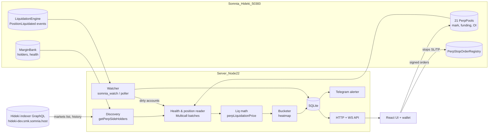

# Liquidation Bounty Board: Design Doc (hackathon MVP)

> **Hackathon:** dreamDEX x Somnia Perps Builder Bounty, **MVP track** (3 winners x $500)
> **Rule that matters most:** the product must be worth using and must place **real orders on dreamDEX perps** on Somnia **Hideki testnet (chain 50383)**.
> **Deadline:** Nov 1 2026, 23:59 UTC (= 23:59 Accra time). **Our target: done by Nov 1, 18:00 UTC.**
> **Builder:** Richard (solo), Linux, Node 22.
> **Working title:** Liquidation Bounty Board. **Recommended final name: "Wipeout Map"** (see §18).

How to read the labels in this doc:
- ✅ **VERIFIED LIVE**: run against Hideki RPC/indexer on Oct 26, 2026 (~20:50 UTC) with `@somnia-chain/markets-sdk@0.32.1`. The probe scripts are in `/workspace/liq-board/probe/`.
- 📘 **VERIFIED IN DOCS**: read in the SDK's own shipped docs (`node_modules/@somnia-chain/markets-sdk/docs/PERPS.md`, `REACTIVITY.md`, `reference/networks-and-endpoints.md`) or type files. Not run yet.
- ⚠️ **UNVERIFIED**: our assumption. Check it on day 1.

---

## 0. Feasibility verdict (read this first)

**Verdict: FEASIBLE. We can list every open position on every perps market, straight from the chain.**

What we found live tonight:

| Check | Result |
|---|---|
| Perps markets listed by the Hideki indexer | ✅ **21** (ZRO, LIT, VVV, 1000PEPE, PUMP, ZEC, TAO, WLD, NEAR, XLM, AVAX, LINK, SUI, ADA, BNB, DOGE, XRP, HYPE, SOL, ETH, BTC), all quoted in **USDso** |
| Enumerate all holders | ✅ `client.getPerpSideHolders({marginBank, pool, isLong})` returned **11,177 open position entries** in total (long + short across 21 markets). For example, BTC had 5,819 longs and 321 shorts, ETH 335/180, SOL 373/205, and ZRO 19/7. A full sweep of all 42 (market, side) lists took about 30 s. |
| Per-position fields | ✅ `getPerpPosition` returns `size` (signed, 18 decimals), `avgEntryPrice`, and `entryFundingIndex`. Example ZRO long: size 183, entry 1.7885. |
| Account health | ✅ `getAccountHealth` returns `equity`, `imReq`, `mmReq`, `cmReq`, `marginStatus` (e.g. "Healthy") |
| Liquidation price | ✅ `getLiquidationPrice` works. In a sample of 40 ETH longs (mark ≈ $2,311.92), 9 had a finite liq price ($246 to $1,782). The rest returned 0/null (over-collateralised: no price move can liquidate them). |
| Mark / index / funding | ✅ `getPerpState(pool)`: markPrice, indexPrice, fundingRate, nextFundingAt, openInterest, oracle. ETH OI was 931.8 ETH. Funding window 28,800 s (8 h), applied every 3,600 s (hourly). |
| Max leverage | ✅ For ETH, `initialMarginBps` = 500, so 20x max. For ZRO it is 2000, so 5x max. |
| Somnia Reactivity | ✅ On the Hideki WebSocket (`wss://api.hideki2.infra.testnet.somnia.network/ws`), `eth_subscribe("somnia_watch", …)` **was accepted** and returned a subscription id. `newHeads` streams fine. ⚠️ We have **not yet seen a real event delivered with its eth_call results**, so we treat it as "works, needs a day-1 smoke test", with a poller fallback. Note: calling `somnia_watch` as a plain RPC method returns "method not found". It is a subscription type, not a method. |

**The honest catch is speed, not access.** Our naive probe read about 1 position per second (two sequential reads per position). Reading 11k positions one by one would take hours. The fix is in the design (§6): read **health once per account** (many positions share an account), batch through Multicall3 (`0xcA11bde05977b3631167028862bE2a173976CA11`, predeployed on Hideki), and compute liq prices **locally** with the SDK's own pure formula. Then refresh only what changes. ⚠️ Our estimate is that a full rebuild takes 1–3 minutes and incremental updates take seconds. We measure this on day 1.

**Second catch: dreamDEX is cross-margin.** One account's collateral backs all of its positions. A position's liquidation price therefore depends on the account's other positions. We use the SDK's single-market solve (the same one the dreamDEX UI uses) and label it "estimate if only this market moves" (§6.3). Isolated margin exists only as "one wallet per position" (linked wallets). Those positions are naturally exact.

---

## 1. Pitch

Every perps trader asks two questions: **"Where do I get wiped out?"** and **"Where does everyone else get wiped out?"** On centralized exchanges the second answer is hidden, and people pay for guessed "liquidation heatmaps". On dreamDEX, positions are **onchain and public**, so we can compute the real map instead of guessing.

**Wipeout Map** (working title: Liquidation Bounty Board) shows, for each of the 21 dreamDEX perps markets:
1. **A live liquidation heatmap.** These are the price levels where open positions get liquidated, sized by how much notional dies there.
2. **"Am I at risk?"** Paste any address or connect a wallet. You see your distance to liquidation, and one tap places a **real** fix order (reduce, set stop, add margin). Optional Telegram alerts.
3. **"Ride the cascade."** Place a **real** stop or limit entry just beyond a big liquidation cluster, with a mandatory stop-loss.
4. **A live liquidation feed.** Every liquidation on dreamDEX appears the moment it happens.

## 2. Why it can win

- **It uses the thing that only an onchain order book has.** CEX heatmaps are estimates. Ours are computed from actual positions. That makes a strong judge story: "only possible on dreamDEX".
- **Real orders, three kinds:** reduce-only market/limit, stop orders with linked SL/TP (`placePerpStopOrder`), and entry orders. All are on Hideki, with tx hashes in the UI.
- **Useful to every trader on day one, including the judges.** They paste their own address and see their liq price.
- **The data is real and big enough.** 11,177 live positions means the heatmap won't look empty (unlike our earlier fear). We still add an honestly labelled demo-bot layer only if a market looks thin (§13).
- **Feedback value.** We exercise rarely used SDK reads (side holders, bankruptcy price, ADL queue) and report any friction.

## 3. Users and flows

**A. Anyone (read-only, no wallet)**
1. Open the site. The default market is BTC. The heatmap shows price on the Y axis with the mark price line, and bars left/right for longs/shorts that liquidate at each level.
2. Hover a bar to see "$412k of longs liquidate between $61,200 and $61,400 (37 positions)".
3. Watch the live feed on the right: "PositionLiquidated · ETH long 1.99 · $1,536.8 · 4s ago".

**B. Trader checking risk ("Fix my position")**
1. Paste an address or connect a wallet (Hideki, chain 50383).
2. See a card per position: size, entry, mark, liq price, distance %, and a status of Healthy / Warning (<15% away) / Danger (<5% away).
3. Tap a fix:
   - **Reduce 25/50%**: real reduce-only order.
   - **Set stop**: real `placePerpStopOrder` with the trigger above (for a long) the liq price.
   - **Add margin**: deposit USDso into the MarginBank.
   Before you confirm, the UI shows the **projected** liq price (`previewPerpLiquidationPrice`).
4. Optional: "Alert me on Telegram when distance < X%".

**C. Trader riding a cascade**
1. On the heatmap, click a big cluster, e.g. a long cluster at $61.2k below a $63k mark.
2. Choose a template, "Short the break": stop-entry sell at cluster top − 0.2%. Stop-loss is required (default: back above cluster top + 1%). TP is optional (default: cluster bottom − 1%).
3. Confirm. The app shows margin needed and projected liq price, then places a real stop order with linked SL/TP.
4. Your order appears as a marker on the heatmap.

## 4. Architecture

One Node 22 process runs the indexer worker, the HTTP/WebSocket API, and the alert bot. One SQLite file. The front end is a static Vite + React build served by the same process. Orders are **signed in the user's wallet** (browser). The server never holds user keys.



## 5. Data sources (what each one is for)

| Need | Source | Status |
|---|---|---|
| Market list, pool + marginBank + stopRegistry addresses, tick/lot size, IM bps | `client.listPerpMarkets()` (indexer) | ✅ live |
| Every open position (who) | `client.getPerpSideHolders({marginBank,pool,isLong})`, pinned to one block (`asOfBlock`) | ✅ live |
| Position size/entry | `client.getPerpPosition(ref)` (chain) | ✅ live |
| Per-account bulk positions | `client.listPerpPositions(account)` (one indexer call, **not** marked to market) | 📘 docs |
| Account equity, mmReq | `client.getAccountHealth(marginBank, account)` | ✅ live |
| Liq price | `client.getLiquidationPrice(ref)` or pure `perpLiquidationPrice(...)` | ✅ live / 📘 pure fn |
| Contract's own bankrupt value | `client.getBankruptcyPrice(ref, {blockNumber})` | 📘 docs |
| Mark, index, funding, OI | `client.getPerpState(pool)`; `getPerpFeedStatus(pool)` for health checks | ✅ live |
| Liquidation events | `liquidationEngineEventsAbi`: `PositionLiquidated`, `AccountLiquidated`, `LiquidationFeeCharged`, `LiquidationKeeperRewardPaid` | 📘 ABI in SDK |
| Maintenance margin bps per market | SDK margin params (`maintenanceMarginBps` in `dist/perp/margin.d.ts`). The docs say it is "exposed nowhere else". | 📘 types; ⚠️ exact read name to confirm |

Endpoints:
- RPC: `https://api.hideki2.infra.testnet.somnia.network`, WS: `wss://…/ws` (Hideki **v2**, regenesised Sep 17, 2026; same chain id as v1, so always use the SDK's `hidekiTestnet` chain export).
- Indexer: `https://hideki-dev.smk.somnia.host/v1/graphql`. 📘 The docs call it **development-grade, no alerting**, so a stall can go unnoticed. We treat the chain as the source of truth and the indexer as a convenience.
- Addresses: `SOMNIA_HIDEKI_TESTNET_ADDRESSES` from the SDK.

## 6. Data pipeline

### 6.1 Position discovery
1. On boot, `listPerpMarkets()` gives 21 markets.
2. For each market and side, call `getPerpSideHolders`. This gives (pool, side, account, asOfBlock). We found 11,177 rows.
3. Group by **account**. Many positions share one account (cross margin), so we need far fewer health reads than positions. ⚠️ We count unique accounts on day 1.
4. For each account: one `getAccountHealth` and its positions (`listPerpPositions` from the indexer for speed, then chain-confirm the size for any position within 15% of liquidation).
5. Use Multicall3 batching and run with a concurrency of about 16 to stay polite to the public RPC.

### 6.2 Liquidation price formula
dreamDEX liquidates when **account equity == maintenance requirement (mmReq)**. mmReq for a position is `ceil(|size| × mark × mmBps / 10000)` (in token units). It is recomputed at the current mark, so both sides move as the price moves. Solving for the mark `p` where they meet (📘 from PERPS.md, the SDK's own solve):

```
long:  p = mark − (equity − mmReq) × 10000 / (|size| × (10000 − mmBps))
short: p = mark + (equity − mmReq) × 10000 / (|size| × (10000 + mmBps))
```

(Raw integer form in the SDK multiplies by `oneBase`, which is 1e18 here.) If the long result is ≤ 0, the position **cannot be liquidated by price alone**. That explains the 31 of 40 ETH longs that returned 0.

Plain-English example: you're long 2 ETH at mark $2,312, equity $1,000 and mmReq $50. You have $950 of "spare" equity. Each $1 the price drops costs you $2, slightly cushioned by mmReq shrinking. So you liquidate about $950 / (2 × 0.99…) ≈ $480 lower, near $1,832.

We call the SDK's exported pure `perpLiquidationPrice(...)` rather than reimplementing it, so we match `getLiquidationPrice` exactly. The penalty when liquidated is up to 1% (from earlier research, ⚠️ re-check).

### 6.3 Cross-margin approximation (be honest in the UI)
The formula holds **all other markets still**. If an account is long BTC and long ETH and both fall together, it liquidates **sooner** than either number says. UI label: "Liq price (if only this market moves)". For accounts with positions in 2+ markets, we show a small "cross" badge. Linked-wallet (isolated) accounts have one position each, so their number is exact.

### 6.4 Heatmap buckets
- Bucket width = max(tickSize, mark × 0.25%). Show ±30% around the mark.
- For each position with a finite liq price inside the window, add `|size| × liqPrice` (USDso notional) to the bucket, split into longs (below the mark) and shorts (above).
- Store a count, the sum of notional, and the top 3 accounts per bucket.
- A **cluster** is a run of adjacent buckets whose total is ≥ 2× the median non-empty bucket. Clusters drive "Ride the cascade" and the labels.
- Also show "safe" positions as a grey footnote: "4,120 positions have no liquidation price within reach".

### 6.5 Refresh cadence
| What | How often |
|---|---|
| Mark/funding/OI (21 markets) | every 2 s (one multicall) |
| Liq prices | Recomputed from cached equity/mmReq on every mark tick. This is cheap and needs no RPC. |
| Account health | When the account is "dirty" (a trade, liquidation, deposit or funding event touched it), and every 60 s for accounts within 10% of liquidation |
| Full holder re-sweep | every 5 min (≈30 s each) |
| Funding drift | Health refresh at each hourly funding settlement (`nextFundingAt`) |

## 7. Order execution (all real, all signed by the user)

Every order flow does the following:
1. **Preflight:** `previewPerpOrderMargin` and `previewPerpLiquidationPrice` show "liq moves from $X to $Y".
2. Wallet signature in the browser (viem + injected wallet). Fallback for demo/power users: a **Linked Bot** key that can place, cancel and reduce but **never withdraw** (from prior research, ⚠️ confirm on Hideki).
3. Record the tx hash, link to it, and poll until filled or resting.

**Fix my position**
- *Reduce X%:* reduce-only marketable limit at mark ± 0.5% slippage. Uses `placePerpOrder` (no `userData` field, so we tag orders in our own DB by tx hash).
- *Set stop:* `placePerpStopOrder` with trigger = liq price + buffer (long: liq × 1.03; short: liq × 0.97), reduce-only, optional linked TP.
- *Add margin:* MarginBank deposit of USDso. Show the new liq price first.

**Ride the cascade**
- Templates: "Short the long-cluster break" and "Long the short-squeeze".
- Entry: stop order whose trigger sits just past the cluster edge, or a resting limit inside the cluster for mean-reversion takers.
- **SL is mandatory** (the UI won't enable the Place button without it), and is linked via `placePerpStopOrder`'s SL/TP.
- Hard caps in the UI: leverage ≤ 5x, size ≤ 20% of free equity, and a warning if SL distance > 3%.
- ⚠️ Confirm on day 1: the exact order-type enum (IOC/GTC/post-only) and whether stop entries (not just stop-closes) are allowed. If stop *entries* are not supported, we fall back to: our watcher sees the trigger, then the user's Linked Bot places a marketable limit plus an SL. We'll say so in the README.

## 8. Alerts
- **In-app:** a toast plus a red banner when a watched position crosses Warning (<15%) or Danger (<5%).
- **Telegram (optional):** the user opens `t.me/<bot>`, sends `/watch 0xabc…`, and we store chat_id ↔ address. Messages: "⚠️ Your ETH long is 4.1% from liquidation ($1,832). [Fix it]" with a deep link to the fix screen. Throttle to 1 per position per 10 min. Stop with `/stop`.
- **Liquidation feed alerts:** "🔥 $250k+ liquidated on BTC" to a public channel (optional, good for X posts).

## 9. Live liquidation feed
- **Primary:** Somnia Reactivity. We subscribe via `eth_subscribe("somnia_watch", {address: LiquidationEngine, topics: [PositionLiquidated], eth_calls: [getPerpState(pool)]})`. Each event then arrives with the mark at that block. ✅ The subscription was accepted on Hideki. ⚠️ Delivery is not yet observed.
- **Fallback:** standard `eth_subscribe("logs")` or `eth_getLogs` polling every 2 s on the LiquidationEngine address.
- **Backfill:** indexer history on boot (last 24 h), if the indexer exposes liquidation entities (⚠️ check schema).
- **Stretch:** Solidity reactivity / Schedule needs 32 STT in the subscription owner. Skip it for the MVP.
- Each feed row shows market, side, size, price, penalty, keeper reward, and "Was on our map? ✅ predicted at $X". That last part shows judges the map works.

## 10. UI screens
1. **Map (home):** market tabs (21), the heatmap with mark line, cluster labels, a funding/OI strip, and the live feed on the right.
2. **My Risk:** address box / Connect, position cards with a distance gauge and Fix buttons.
3. **Fix sheet:** order form with current → projected liq price, and Confirm.
4. **Cascade sheet:** cluster summary, template, entry/SL/TP prefilled, and margin needed.
5. **Feed page:** full liquidation history with filters.
6. **About/Data honesty:** how the numbers are made, staleness, and the demo-bot label.

## 11. Data model (SQLite)
```
markets(pool PK, symbol, margin_bank, stop_registry, tick, lot, im_bps, mm_bps,
        mark, index_px, funding_rate, oi, next_funding_at, updated_block)
accounts(account PK, margin_bank, equity, mm_req, im_req, status, markets_count,
         is_demo_bot, updated_block, dirty)
positions(pool, account, PK(pool,account), size_signed, entry, liq_price,
          liq_kind  -- 'finite'|'unreachable', updated_block)
buckets(pool, side, price_lo, price_hi, notional, count, top_accounts_json, computed_at)
liquidations(tx, log_index PK, pool, account, side, size, price, penalty, keeper,
             predicted_liq, block, ts)
alerts(chat_id, account, threshold_pct, last_sent_at)
app_orders(tx PK, account, pool, kind -- fix_reduce|fix_stop|add_margin|cascade_entry,
           params_json, status, created_at)
```

## 12. API
| Method | Path | Returns |
|---|---|---|
| GET | `/api/markets` | 21 markets with mark, funding, OI, data age |
| GET | `/api/heatmap/:symbol?range=30` | buckets, clusters, mark, asOfBlock, stale flag |
| GET | `/api/account/:address` | positions plus liq price, distance, cross badge |
| POST | `/api/preview` | {pool, side, qty, price}, returns margin and projected liq (server calls SDK preview) |
| GET | `/api/liquidations?symbol=&limit=` | feed |
| WS | `/ws` | `mark`, `bucket_update`, `liquidation`, `account_risk` messages |
| POST | `/api/alerts` | register a Telegram watch (from the bot) |

Orders are **not** an API endpoint. They are built and signed in the browser with the SDK. This keeps the server keyless.

## 13. Safety and failure modes
| Risk | Mitigation |
|---|---|
| **Stale data** | Every number shows "as of block N, Xs ago". The heatmap greys out and says "stale" if older than 30 s. The Fix buttons always re-read the chain before signing. |
| **Indexer stall** (dev-grade) | Chain-only fallback: holders, positions and health all come from the RPC. The indexer only speeds things up. |
| **Cross-margin approximation** | Label "if only this market moves" plus a cross badge. For Danger alerts we also show the account-level margin ratio (equity / mmReq), which is exact. |
| **Dead/rotated oracle** | `getPerpFeedStatus` per market. If the mark is not ok, hide that market's map and disable orders. |
| **RPC rate limits** | Multicall batching, concurrency cap, exponential backoff, and a 5-min full sweep instead of constant sweeps |
| **Thin liquidity / slippage** | Reduce orders are marketable limits with a 0.5% cap, never raw market orders. Show book depth before confirming. |
| **Sparse heatmap on small markets** (e.g. ZRO had only 26 positions) | Show the count honestly. Optional **demo bots**: 5–10 wallets we fund with paper USDso to open small positions on 2–3 thin markets. These are flagged `is_demo_bot` and drawn **hatched**, and a toggle "include demo bots" is **off by default**. The README says this plainly. With 11k real positions we probably won't need it. |
| **Cascade trades are risky** | Mandatory SL, leverage cap 5x, a size cap, and a "testnet / not advice" banner |
| **Wrong network** | Assert chainId 50383 and use the SDK's `hidekiTestnet` export (v2 endpoints). Never hand-write the chain. |
| **Privacy** | Positions are public onchain anyway. We show addresses truncated and keep no off-chain personal data except Telegram chat ids (deletable via `/stop`). |

## 14. Stack
- Node 22, TypeScript, `@somnia-chain/markets-sdk@0.32.1`, `viem`, `@somnia-chain/reactivity@0.2.1` (optional peer for `/reactivity`), `ws`.
- Server: Fastify plus `better-sqlite3`. Telegram: `grammy`.
- UI: Vite + React + Tailwind. Heatmap with a simple canvas or `visx` bars (no heavy chart lib). Wallet: viem plus an injected wallet (MetaMask) with a custom chain 50383.
- Hosting for judging: a small VPS or Railway/Fly (one process), plus a public URL in the README.

## 15. Repo layout
```
liq-board/
  DESIGN.md  README.md  .env.example
  probe/                 # day-0 feasibility scripts (kept as evidence)
  server/
    src/config.ts        # hidekiTestnet, addresses, indexer URL
    src/discovery.ts     # side holders sweep
    src/health.ts        # batched health/position reads
    src/liqmath.ts       # wraps perpLiquidationPrice + bucketing
    src/watcher.ts       # somnia_watch with logs-poll fallback
    src/api.ts  src/ws.ts  src/telegram.ts  src/db.ts
  web/
    src/pages/Map.tsx  MyRisk.tsx  Feed.tsx
    src/components/Heatmap.tsx FixSheet.tsx CascadeSheet.tsx
    src/lib/orders.ts    # SDK order builders (reduce, stop+SL/TP, deposit)
  bots/demo-seed.ts      # optional, labelled demo positions
  feedback/SDK-NOTES.md  # friction found (feedback track)
```

## 16. 5-day build plan (Accra time = UTC)
| Day | Work | Done when |
|---|---|---|
| **Tue Oct 27** | Wallet + paper USDso. Place 1 real reduce-only order, 1 stop with linked SL/TP, 1 deposit. Find the mmBps read. Count unique accounts. Time a batched full sweep. Smoke-test somnia_watch delivery. | 3 tx hashes; sweep time measured; reactivity yes/no |
| **Wed Oct 28** | Server: discovery, health, liqmath, buckets, SQLite, `/api/heatmap`, `/api/account`. Logs poller for liquidations. | curl shows BTC buckets and a real account's liq price matching `getLiquidationPrice` |
| **Thu Oct 29** | UI: Map + Feed + My Risk (read-only). WS live updates. | Heatmap moves with the mark in the browser |
| **Fri Oct 30** | Fix sheet + Cascade sheet with real orders. Preflight previews. Telegram alerts. | Orders from the UI land on Hideki |
| **Sat Oct 31** | Reactivity upgrade (if it works), stale/oracle guards, demo bots only if needed, deploy, README, feedback notes. | Public URL works from a fresh browser |
| **Sun Nov 1** | Record the 60 s video, X posts, submit by **18:00 UTC**. Buffer until 23:59. | Submitted on DoraHacks |

Cut list if late (in order): Telegram → cascade templates beyond one → reactivity (keep poller) → feed backfill.

## 17. 60-second demo script
- **0–8 s:** "On a CEX, liquidation maps are guesses. dreamDEX positions are onchain, so this one is real: 11,000+ open positions across 21 markets."
- **8–20 s:** BTC map. Hover a cluster: "$X of longs die between A and B." Point at the live feed: a liquidation pops, with "predicted at $Y ✅".
- **20–35 s:** Paste a wallet → "ETH long, 4% from liquidation." Tap **Set stop** → preview shows the liq price moving → sign → tx hash on Hideki.
- **35–50 s:** Click a short cluster → "Ride the cascade" → entry, mandatory SL and TP prefilled → sign → the order marker appears on the map.
- **50–60 s:** Telegram alert arrives on the phone. "Wipeout Map: see where everyone gets wiped out, before you do. Built on dreamDEX + Somnia."

## 18. Name ideas
1. **Wipeout Map** (recommended: plain, visual, memorable)
2. Liquidation Bounty Board (working title)
3. Rekt Radar
4. Cascade
5. Margin Call Map

## 19. README "X posts" section (drafts; nothing posted)
1. "Where does everyone on @DreamDEXSomnia get liquidated? Positions are onchain, so we mapped all 11k of them. Live heatmap for 21 perps markets on Somnia ⚡ [link]"
2. "Your liq price, one tap to fix it. Wipeout Map watches any wallet on @DreamDEXSomnia perps and places the real reduce/stop order for you. Testnet demo 👇 [video]"
3. "Ride the cascade: stop-entries just past big liquidation clusters on @DreamDEXSomnia, with mandatory stop-losses. Built in 5 days for the dreamDEX x Somnia Perps bounty."

## 20. Verified vs unverified facts
| Fact | Status |
|---|---|
| `@somnia-chain/markets-sdk` 0.32.1 installs and runs (we used Node 20 on the box; Richard uses 22) | ✅ live |
| 21 perps markets on Hideki, USDso quote | ✅ live |
| Enumerate all positions via `getPerpSideHolders` | ✅ live, 11,177 entries |
| Position fields: signed size, avgEntryPrice, entryFundingIndex | ✅ live |
| Account health: equity, imReq, mmReq, cmReq, marginStatus | ✅ live |
| `getLiquidationPrice` returns a finite value or 0/null when unreachable | ✅ live (9/40 finite on ETH longs) |
| Mark, index, funding rate, OI, nextFundingAt via `getPerpState` | ✅ live |
| Funding: 8 h window, hourly settlement | ✅ live (28,800 s / 3,600 s) |
| Max leverage = 10000 / initialMarginBps (ETH 20x, ZRO 5x) | ✅ live for those two |
| Hideki RPC/WS v2 endpoints; Multicall3 predeployed | ✅ RPC/WS live; 📘 Multicall |
| Indexer URL `hideki-dev.smk.somnia.host/v1/graphql`, dev-grade | ✅ live (used by listPerpMarkets); 📘 dev-grade |
| `somnia_watch` subscription accepted on Hideki WS | ✅ live (sub id returned) |
| `somnia_watch` delivers events with eth_call results on Hideki | ⚠️ not yet observed |
| Liq formula (equity == mmReq, mmReq at current mark) | 📘 PERPS.md |
| Margin is cross; isolated only via linked wallets | 📘 PERPS.md |
| LiquidationEngine events (PositionLiquidated, etc.) | 📘 SDK ABI |
| Exact per-market maintenance bps read | ⚠️ in types, read name TBC |
| Liquidation penalty up to 1% | ⚠️ prior research |
| 1,000 paper USDso one-time credit | ⚠️ prior research |
| Link a Bot on perps: place/cancel/reduce, never withdraw | ⚠️ prior research |
| `placePerpStopOrder` linked SL/TP; `placePerpOrder` has no userData | 📘 prior type check |
| Stop *entry* (not just stop-close) orders allowed | ⚠️ day 1 |
| Full sweep time with batching (1–3 min est.) | ⚠️ day 1 (naive probe ≈ 1 pos/s) |
